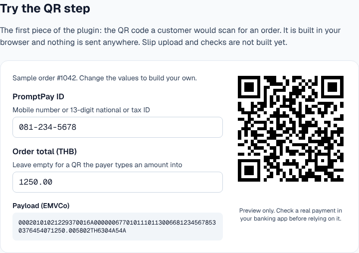

# PromptPay Flow

**Live page:** [promptpay-storefront.vercel.app](https://promptpay-storefront.vercel.app) (status: in development; landing page with a QR preview)

This repository is the landing page for PromptPay Flow, a planned
WooCommerce plugin for PromptPay QR payments and slip checks in stores in
Thailand. The plugin is not released. Only its QR step is in this
repository, as a browser preview. There is no download, no price and no checkout.

## What is here

- A one-page [Next.js](https://nextjs.org) 16 site (App Router, React 19,
  Tailwind CSS 4). The page lives in `app/page.tsx`.
- The page tells search engines not to index it (`robots: noindex`) until
  there is a release.
- A client-side QR preview (`app/qr-builder.tsx`, `lib/promptpay.ts`).
  No backend, no API routes and no environment variables.

## What the plugin is planned to do

These are plans, not finished features.

- Show a PromptPay QR code (EMVCo format) set to the exact order total.
- Let the customer upload a transfer slip on the order page.
- Optionally check each slip with a verification service such as SlipOK or
  EasySlip, using the store's own account.
- Reject a slip that was already used for another order.
- Update the WooCommerce order status after a slip passes the check.

To follow progress, watch this repository on GitHub.

## Demo: the QR step

The live page has a working preview of the plugin's first step. It builds the
PromptPay QR code for an order total in the browser, using a sample order
(#1042, 1,250.00 THB, placeholder number 081-234-5678) until you change the
values. Nothing is sent to a server.



- `lib/promptpay.ts` builds the EMVCo payload: PromptPay application ID,
  mobile number (as `0066` plus the number) or 13-digit ID, currency 764,
  amount, country TH and a CRC-16/CCITT-FALSE checksum.
- `npm test` runs its unit tests (Node's built-in test runner, Node 22.6+).
- `npm run demo` builds and serves the page on http://localhost:3000.

It is a preview. Slip upload, slip checks and the WooCommerce plugin are not
built yet.

## Run it locally

Requires Node.js 20.9 or later (CI uses Node 22) and npm.

```bash
npm ci
npm run dev     # http://localhost:3000
npm test
npm run lint
npm run build
```

## Not affiliated

PromptPay Flow is an independent project. It is not affiliated with, or
endorsed by, the Bank of Thailand, PromptPay, WooCommerce, SlipOK or
EasySlip. Product names belong to their owners.

## License

MIT. See [LICENSE](LICENSE). It covers this landing page only; the planned WordPress plugin will need its own license (GPLv2 or later) if it is released.
