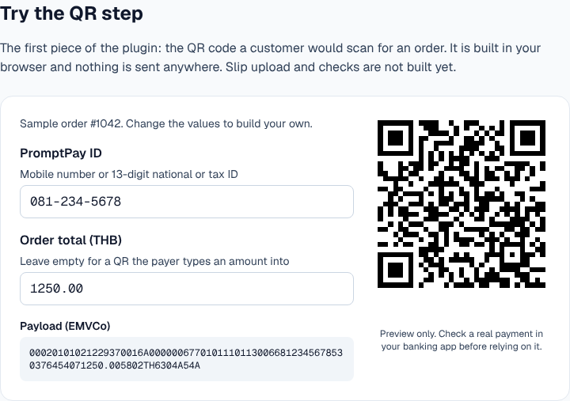

<div align="center">

# PromptPay Flow

**Build a PromptPay QR code for an exact order total, right in the browser. The landing page and QR preview for a planned WooCommerce plugin.**

[](https://github.com/tahmidbintaslim/promptpay-storefront/actions/workflows/ci.yml)
[](https://github.com/tahmidbintaslim/promptpay-storefront/actions/workflows/codeql.yml)
[](LICENSE)
[](https://github.com/tahmidbintaslim/promptpay-storefront/commits/main)
[](https://promptpay-storefront.vercel.app)
[](https://github.com/tahmidbintaslim/promptpay-storefront/stargazers)

</div>

**Live page:** [promptpay-storefront.vercel.app](https://promptpay-storefront.vercel.app) (status: in development; landing page with a QR preview)

This repository is the landing page for PromptPay Flow, a planned
WooCommerce plugin for PromptPay QR payments and slip checks in stores in
Thailand. The plugin is not released. Only its QR step is in this
repository, as a browser preview. There is no download, no price and no checkout.



## Quick start

Requires Node.js 20.9 or later and npm.

```bash
git clone https://github.com/tahmidbintaslim/promptpay-storefront.git
cd promptpay-storefront
npm ci
npm run dev     # http://localhost:3000
```

Or open the [live page](https://promptpay-storefront.vercel.app) and use the QR preview there.

## Contents

- [What is here](#what-is-here)
- [What the plugin is planned to do](#what-the-plugin-is-planned-to-do)
- [Demo: the QR step](#demo-the-qr-step)
- [Known limitations](#known-limitations)
- [Run it locally](#run-it-locally)
- [Contributing](#contributing)
- [Security](#security)
- [Not affiliated](#not-affiliated)
- [License](#license)

## What is here

- A one-page [Next.js](https://nextjs.org) 16 site (App Router, React 19,
  Tailwind CSS 4). The page lives in `app/page.tsx`.
- The page tells search engines not to index it (`robots: noindex`) until
  there is a release.
- A client-side QR preview (`app/qr-builder.tsx`, `lib/promptpay.ts`).
  No backend, no API routes and no environment variables.

## What the plugin is planned to do

These are plans, not finished features.

- Show a PromptPay QR code (EMVCo format) set to the exact order total.
- Let the customer upload a transfer slip on the order page.
- Optionally check each slip with a verification service such as SlipOK or
  EasySlip, using the store's own account.
- Reject a slip that was already used for another order.
- Update the WooCommerce order status after a slip passes the check.

To follow progress, watch this repository on GitHub.

## Demo: the QR step

The live page has a working preview of the plugin's first step. It builds the
PromptPay QR code for an order total in the browser, using a sample order
(#1042, 1,250.00 THB, placeholder number 081-234-5678) until you change the
values. Nothing is sent to a server.

- `lib/promptpay.ts` builds the EMVCo payload: PromptPay application ID,
  mobile number (as `0066` plus the number) or 13-digit ID, currency 764,
  amount, country TH and a CRC-16/CCITT-FALSE checksum.
- `npm test` runs its unit tests (Node's built-in test runner, Node 22.6+).
- `npm run demo` builds and serves the page on http://localhost:3000.

It is a preview. Slip upload, slip checks and the WooCommerce plugin are not
built yet.

## Known limitations

In this repository:

- **Preview only.** The page builds a QR payload and draws it in the browser
  with the [`qrcode`](https://www.npmjs.com/package/qrcode) package. It does
  not create orders, take payments or confirm transfers. As the page says,
  check a real payment in your banking app before relying on it.
- **No slip upload or slip checks.** The page has no upload box; both are
  planned features, not built.
- **The PromptPay ID gets a format check only.** `parseTarget()` accepts a
  10-digit number starting with 0 or any 13 digits. It does not verify the
  check digit of a 13-digit national or tax ID, and it does not accept
  15-digit e-wallet IDs.

In the plugin prototype (a separate repository that is not public yet):

- The slip upload box on the order page and the "Pro License Activation Key"
  field do nothing yet.
- Saving the setup wizard shows a developer alert.
- The QR image comes from `api.qrserver.com`, which sends the merchant's
  PromptPay ID and the order amount to that third party. The preview on this
  page does not do that.
- Classic (shortcode) checkout only: no Checkout block support and no
  High-Performance Order Storage (HPOS) compatibility declaration.
- The settings page does not validate the PromptPay ID.

## Run it locally

Requires Node.js 20.9 or later (CI uses Node 22) and npm.

```bash
npm ci
npm run dev     # http://localhost:3000
npm test
npm run lint
npm run build
```

## Contributing

Issues and pull requests are welcome. See [CONTRIBUTING.md](CONTRIBUTING.md)
for setup and the checks CI runs.

## Security

Please report vulnerabilities privately, not in a public issue. See
[SECURITY.md](SECURITY.md).

## Not affiliated

PromptPay Flow is an independent project. It is not affiliated with, or
endorsed by, the Bank of Thailand, PromptPay, WooCommerce, SlipOK or
EasySlip. Product names belong to their owners.

## License

MIT. See [LICENSE](LICENSE). It covers this landing page only; the planned WordPress plugin will need its own license (GPLv2 or later) if it is released.
